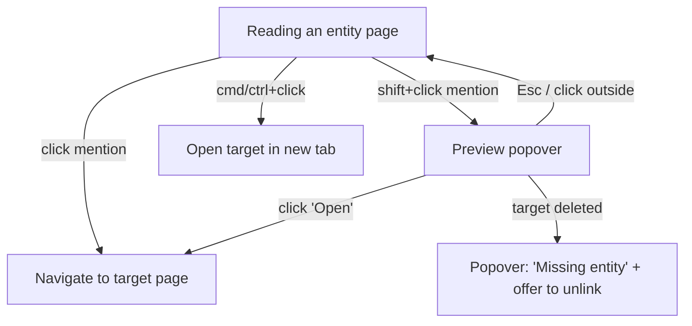
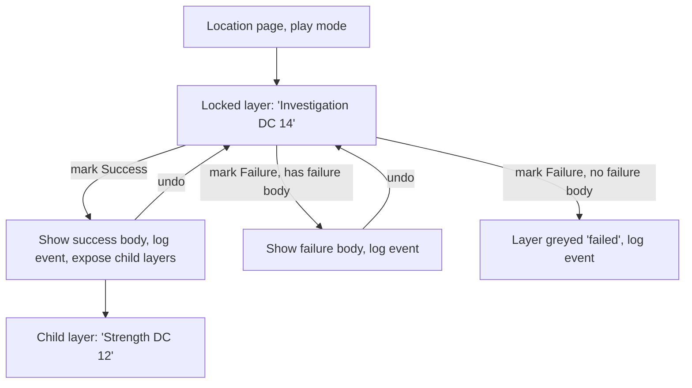
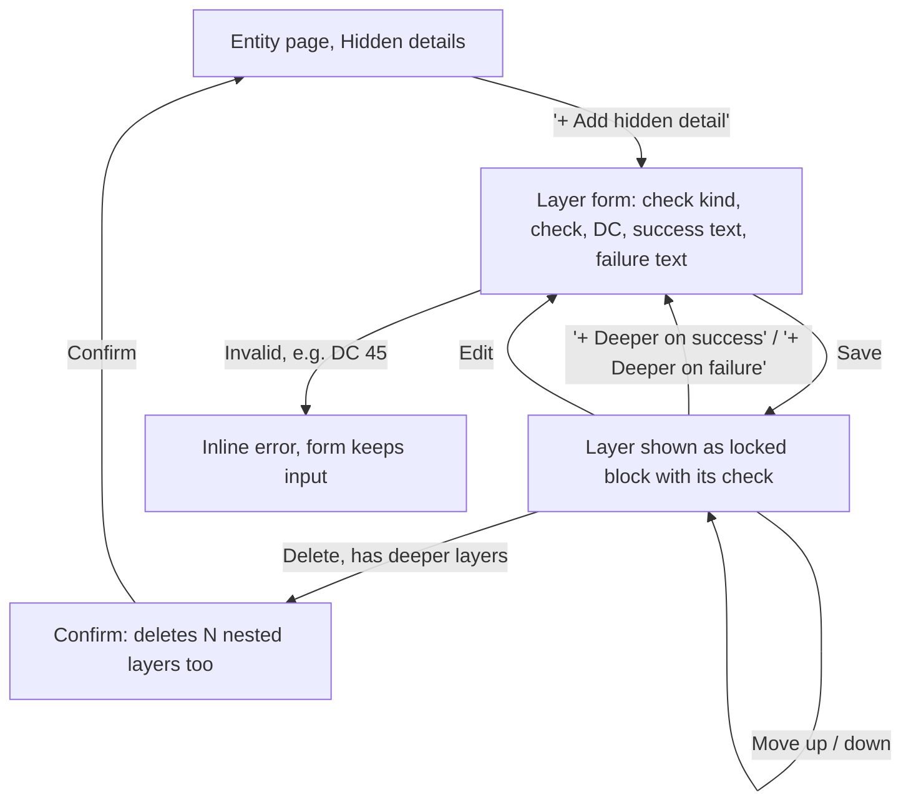
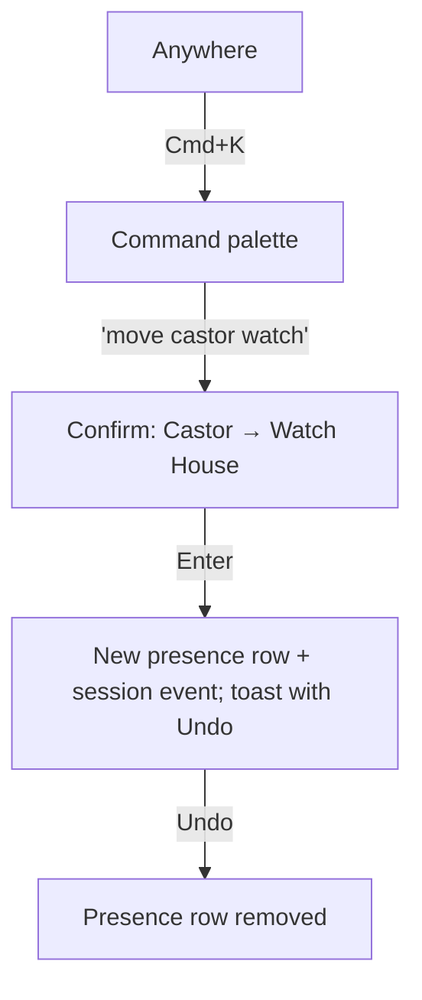

# Campaign Codex — Plan

A local-only web app for prepping and running a single D&D campaign: a linked wiki of
regions, locations and characters, with layered descriptions gated by skill checks, and a
play mode that tracks what happens at the table.

## Working agreement

- Work happens in **slices**: one slice = one branch = one PR, budget **~400 changed lines**
  (excluding lockfiles, generated migrations, seed data). If a slice grows past that, stop and
  propose a split here instead of continuing.
- Each slice is implemented in a fresh session: read this file, build only that slice, run
  `typecheck`, `lint`, `test` until green, self-review, open a PR against its parent branch.
- Out-of-scope discoveries go in **Parking lot** at the bottom, not into the current diff.
- Update this file in the same PR when a slice changes the plan.

## Stack

| Concern | Choice | Why |
|---|---|---|
| App | Next.js (App Router) + TypeScript | Familiar; server actions keep data access simple |
| UI | Tailwind + shadcn/ui | Popovers, dialogs, command palette out of the box |
| DB | SQLite via `better-sqlite3`, file at `data/codex.db` (gitignored) | Single file, no server, trivial backup |
| ORM | Drizzle (+ drizzle-kit migrations) | SQL-shaped queries (recursive CTEs for reveal trees), typed JSON columns, one schema file per table; Postgres dialect available later |
| Rich text | TipTap (ProseMirror), stored as JSON | First-class mention extension with custom triggers and node views |
| Validation | zod | Guards JSON columns and form input (SQLite won't) |
| IDs | cuid2 strings | Stable link targets; no sequence headaches on a Postgres move |
| Tests | Vitest (data layer), Playwright (interaction flows) | Flows below become e2e tests |
| Maps (phase 4) | Leaflet `CRS.Simple` over exported images | Images from Azgaar / Watabou generators |

### Postgres-readiness rules
1. `PRAGMA foreign_keys = ON` on every connection.
2. No raw SQL outside `src/db/search.ts` (and recursive CTE helpers in `src/db/reveals.ts`).
3. Validate every JSON column with zod on write.
4. Dates as integer timestamps via Drizzle's `timestamp` mode; booleans via Drizzle's boolean mode.
5. Case-insensitive matching (mention autocomplete, search) lives only in `src/db/search.ts`.

## Core concepts

### World vs. table state
- **World** — what the GM authors. Entities, descriptions, reveals, stat blocks. Edited in prep.
- **Table state** — what happens in play. Revealed layers, where NPCs are now, combat HP,
  session log. Resettable without touching the world.

### Entities
One table for every linkable thing, so links, previews, search and backlinks work uniformly.
Types: `region`, `place`, `location`, `character`, `item`, `faction` (more later). Type-specific
fields live in a zod-validated `attributes` JSON column.

#### location/regions can be interconnected.

- Regions can have multiple Locations
- Locations can have multiple Locations (i.e. Living Room has three doorways that each lead to different rooms)
- Consider another level of a place that fits between region and location. e.g. Place can be a neighborhood, a house, etc. that lives within a region and has multiple locations

Two separate relationships cover this:

**Containment** ("what is this inside?") uses `parentId`. Breadcrumbs and "places in this
region" fall out of it. Allowed parents:

| Child | May sit inside |
|---|---|
| `region` | `region` (sub-regions) or nothing |
| `place` (neighborhood, estate, house) | `region`, `place` |
| `location` (a room, a clearing) | `region`, `place`, `location` |
| `item` | `place`, `location`, or nothing |
| `character`, `faction` | nothing (where a character *is* belongs to presence, phase 3) |

Example: Konigsberg (region) ⊃ Habbin Estate (place) ⊃ Habbins House (place) ⊃ Living Room (location).

**Connections** ("where can I go from here?") are a separate `connections` table between any
two spatial entities (`region`, `place`, `location`), even across regions: the living room's
three doorways, a road out of Konigsberg, the hatch to the cellar. Each has a label per
direction ("north doorway" / "south doorway") and is two-way unless marked one-way. Phase 2
lets a connection be **hidden behind a reveal**: the hatch only appears once the Strength
check succeeds.

### Mentions
- Authoring: typing `@` opens a picker; `@char/`, `@loc/`, `@place/`, `@reg/`, `@item/`, `@fac/`
  narrow by type.
- Storage: a TipTap mention node holding `{ entityId }`. The visible label comes from the
  entity's current name, so renames never break links.
- Reading: **click** navigates; **shift+click** opens a preview popover (summary, type-specific
  fields, current location for characters, link to full page); **cmd/ctrl+click** opens in a new tab.
- On save, mentions are extracted into `entity_links` to drive backlinks ("Mentioned in…").

### Reveals (layered descriptions)
A tree hanging off an entity. Each node is a gated layer:

```
Habbins House: "The room is decrepit…"
└─ Investigation DC 14
   ├─ success: "You see blood underneath one of the broken chairs."
   │  └─ Strength DC 12
   │     ├─ success: "Moving the chairs reveals a hatch → @loc/TheHatch"
   │     └─ failure: (none)
   └─ failure (optional): "A rat bolts from the chairs; you're sure nothing's there."
```

Children hang off a node's **success** branch by default; a `branch` column allows nesting
under failure too. Both branch bodies are TipTap docs, so they can contain mentions.

Decisions for phase 2 (each is a proposal; see Open questions):

- **Placement**: reveals form a separate **Hidden details** section under the description, not
  blocks inside it. Easier to author, and play mode (phase 3) can resolve them one by one.
- **Checks**: a reveal's gate is a 5e skill (Investigation, Perception, …), an ability check
  (Strength, …), a saving throw, or **Other** with free text ("Opens the chest", "Speaks Elvish")
  for gates that aren't rolls. DC is optional (1–30), since Other gates often have none.
- **Ordering**: siblings have a `sortOrder`; the authoring UI moves layers up and down.
- **Mentions in reveals** count as links. Backlinks say where: "Living Room (hidden:
  Investigation DC 14)", so you can see that a character only shows up behind a check.
- **Hidden connections**: a connection can point at a reveal (`revealId`). In prep it shows with
  a "hidden" badge naming the check; in play mode it stays hidden until that reveal succeeds.
  The hatch is a hidden exit plus a location, not a special kind of entry.
- **Prep view shows everything.** All layers are visible to the GM, styled as locked layers with
  their check. Hiding things from players is play mode's job (phase 3).

## Data model (target; built incrementally)

```
entities          id, type, name, slug, summary, body(json), attributes(json),
                  parentId→entities, createdAt, updatedAt
connections       id, fromId→entities, toId→entities, label, reverseLabel?, oneWay,
                  revealId→reveals? (phase 2: hidden until revealed), notes?
entity_links      sourceEntityId, sourceRevealId?, targetEntityId   (rebuilt on save;
                  phase 2 adds sourceRevealId so backlinks can say which check hides a mention)
reveals           id, entityId, parentId→reveals?, branch('success'|'failure'),
                  checkKind('skill'|'ability'|'save'|'other'), check, dc?,
                  successBody(json), failureBody(json)?, sortOrder

-- table state (phase 3)
sessions          id, number, title, startedAt, endedAt?, notes(json)
reveal_outcomes   id, revealId, sessionId, outcome('success'|'failure'), rolled?, at
presence          id, characterId, locationId, sessionId?, since, note?   (latest row = current)
session_events    id, sessionId, at, kind, payload(json)                 (append-only log)

-- maps (phase 4)
maps              id, name, imagePath, width, height, entityId?(region it depicts)
pins              id, mapId, x, y, entityId, label?

-- encounters (phase 5)
creatures         id, name, source('srd'|'custom'), statBlock(json)
spells            id, name, source, data(json)
encounters        id, locationId?, name, notes(json)
encounter_members id, encounterId, creatureId? | characterId?, count
combat_state      id, encounterId, sessionId, round, turn, combatants(json)
```

## Key interaction flows

These double as Playwright test specs: one test per path.

### Mention preview


### Resolving a reveal in play mode


### Authoring a reveal (phase 2)


### Moving an NPC mid-session


## Roadmap

1. **Linked wiki** — entities, rich text with mentions, previews, backlinks, quick jump
2. **Reveals** — authoring and rendering layered descriptions
3. **Play mode** — sessions, resolving reveals, NPC presence and quick moves, session log
4. **Maps** — image maps with pins linked to entities, nested maps, NPC tokens
5. **Encounters** — SRD 5.x import (CC-BY-4.0, via Open5e JSON), custom stat blocks,
   initiative/HP/conditions tracker

Only phase 1 is sliced in detail; later phases get sliced when we get there.

## Phase 1 slices

| # | Slice | Builds on | Done when |
|---|---|---|---|
| 1.1 | **Scaffold** — Next.js + TS + Tailwind + shadcn/ui, Drizzle + better-sqlite3 (FK pragma; Next already externalizes better-sqlite3), Vitest, Playwright, scripts `typecheck` `lint` `test` `test:e2e` `db:generate` `db:migrate` `db:seed`, `CLAUDE.md`, `.gitignore` for `data/`. Scaffold into a temp dir and move in (create-next-app refuses non-empty dirs). | — | `npm run dev` serves a placeholder page; all scripts run green |
| 1.2 | **Entities data layer** — `entities` table + migration, zod schemas per type, CRUD functions in `src/db/entities.ts`, containment rules (allowed parents table above), unit tests, seed with Konigsberg / Habbin Estate / Habbins House / Investigator Castor | 1.1 | Tests cover create/read/update/delete, allowed-parent rules, parent cycle prevention, slug uniqueness |
| 1.2b | **Connections data layer** — `connections` table + migration, create/list/delete in `src/db/connections.ts` (list returns exits from an entity's point of view, using `reverseLabel` for two-way links), only spatial endpoints, unit tests, seed the living room's doorways | 1.2 | Tests cover two-way vs one-way exits, non-spatial endpoints rejected, cascade on entity delete |
| 1.3a | **Entity pages (read-only)** — sidebar list grouped by type, entity page at `/e/[slug]` (breadcrumb from parent chain, type, summary, attributes, body rendered read-only, "Inside" children, exits) | 1.2b | Can navigate the seeded Konigsberg data from region down to a room and out through an exit (Playwright) |
| 1.3b | **Entity forms** — create/edit/delete entities (plain-text body, parent picker respecting containment rules, per-type attribute fields) | 1.3a | Can create a region and a location inside it, rename it and delete it (Playwright) |
| 1.3c | **Exit editor** — add/remove exits on spatial entity pages (label, destination, reverse label, one-way) | 1.3b | Can connect two rooms and see the exit from both sides, then remove it (Playwright) |
| 1.4 | **Rich-text editor** — swap body field for TipTap, store JSON, read-only renderer shared with entity page | 1.3b | Body round-trips through save/reload with formatting intact |
| 1.5a | **Mention authoring** — `@` picker in the editor (all types; `char/ loc/ place/ reg/ item/ fac/` prefixes narrow), mention node `{id, label}`, labels refreshed to current names when editing | 1.4 | Can insert mentions by keyboard and they survive save (Playwright) |
| 1.5b | **Mention reading** — render mentions as type-colored chips with current names, click/shift+click/cmd+click behaviour, preview popover, missing-entry chip | 1.5a | Mention-preview flow passes as Playwright tests |
| 1.6 | **Links index + backlinks** — `entity_links` table, rebuilt on save, "Mentioned in" panel, unlink missing targets | 1.5b | Renaming an entity updates every chip; deleting one shows the missing state |
| 1.7 | **Quick jump** — Cmd+K palette searching entities by name (via `src/db/search.ts`) | 1.3a | Jump to any entity in ≤3 keystrokes after the name prefix |

1.7 only needs 1.3a, so it can run in parallel with 1.3b–1.6. 1.2b, 1.3b and 1.3c were split out
to keep each slice under the line budget.

## Phase 2 slices

| # | Slice | Builds on | Done when |
|---|---|---|---|
| 2.1 | **Reveals data layer** — `reveals` table + migration, zod schema (check kinds, 5e skill/ability lists, DC 1–30), CRUD in `src/db/reveals.ts`: create under an entity or another reveal (same entity only), update, delete subtree, reorder siblings, load an entity's tree (recursive CTE, the second raw-SQL file) | 1.7 | Tests cover nesting under both branches, cross-entity parents rejected, subtree delete, reorder, tree order |
| 2.2 | **Hidden details (read-only)** — section on entity pages rendering the tree: check badge ("Investigation DC 14"), success and failure bodies via `RichText`, nested layers indented; seed the Habbins House example | 2.1 | The seeded blood/hatch layers render nested with their checks (Playwright) |
| 2.3 | **Reveal authoring** — add / edit / delete layers from the entity page (form with check picker and two rich-text editors), "+ Deeper on success / failure", move up/down, delete confirmation naming nested count | 2.2 | Authoring flow above passes as Playwright tests |
| 2.4 | **Mentions in reveals** — `entity_links.sourceRevealId`; reveal bodies sync links on save; backlinks show the gating check; unlinking works inside reveals | 2.3 | Castor mentioned only behind a check shows "(hidden: …)" in his Mentioned in |
| 2.5 | **Hidden connections** — `connections.revealId`, "Hidden behind…" picker in the exit editor (reveals of either end), "hidden" badge naming the check on exits | 2.3 | The hatch exit shows as hidden behind Strength DC 12 in prep view |

2.4 and 2.5 are independent of each other once 2.3 lands.

## Open questions

- ~~**Mention syntax**~~ Decided in 1.5a: `@` searches all entries; optional prefixes `char/`,
  `loc/`, `place/`, `reg/`, `item/`, `fac/` narrow by type. Revisit after use.
- **Phase 2 proposals to confirm** (see Reveals): separate Hidden details section rather than
  inline blocks; "Other" gates with free text and optional DC; prep view shows every layer.
  Also: should a check allow **multiple tiers** on one layer (DC 10 → some, DC 15 → more)?
  Proposal: no; model tiers as nested layers or siblings.
- **Player-facing view**: a second window showing only revealed text, for a table screen? (phase 3+)
- **Images on entities** (portraits, handouts)? Stored where — `data/uploads/`?
- **Backups**: copy `data/codex.db` on app start / nightly? (cheap; probably phase 1 parking lot)

## Parking lot

_(Out-of-scope ideas found during slices go here.)_

- **npm 10.9.2 crashes resolving vitest 4/5 peers** (`Cannot read properties of null
  (reading 'edgesOut')`). The lockfile was built with `npx npm@11 install`; plain `npm install`
  works from it. Upgrading global npm to 11 avoids the issue when adding dev dependencies.
- **Remove `@tailwindcss/turbopack` loader?** create-next-app added it to `next.config.ts`;
  check whether it is still needed once styling work starts.
- **Add Prettier with a project config.** Formatting is currently by hand (~110-char lines);
  a config plus a `format` script would keep agent-written code consistent.
