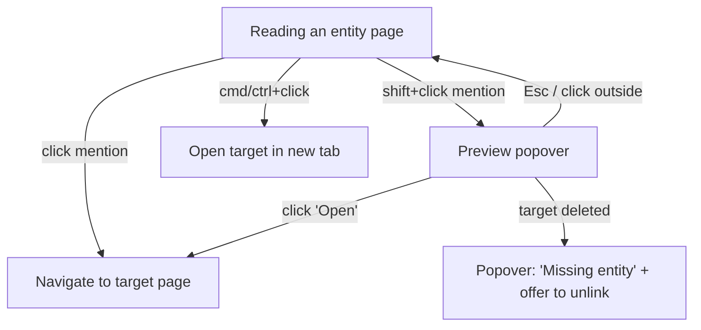
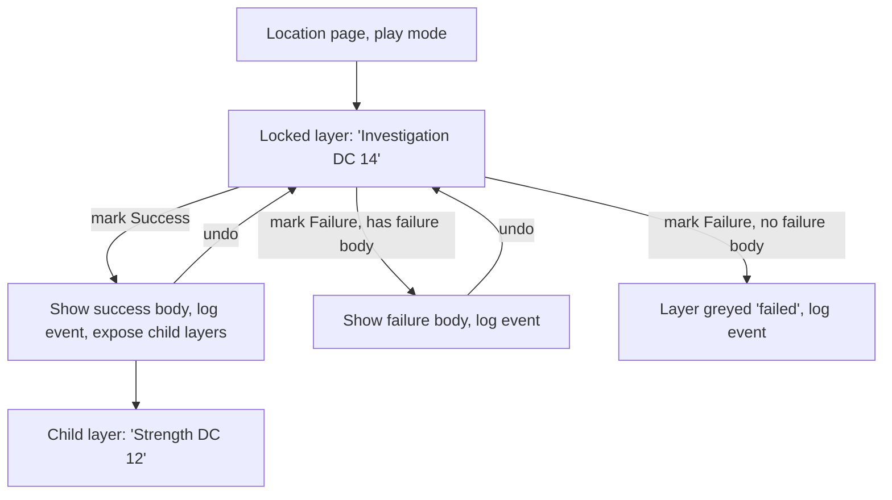
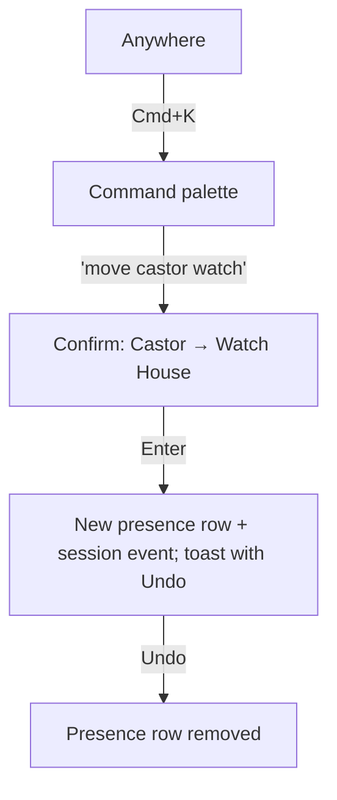

# Campaign Codex — Plan

A local-only web app for prepping and running a single D&D campaign: a linked wiki of
regions, locations and characters, with layered descriptions gated by skill checks, and a
play mode that tracks what happens at the table.

## Working agreement

- Work happens in **slices**: one slice = one branch = one PR, budget **~400 changed lines**
  (excluding lockfiles, generated migrations, seed data). If a slice grows past that, stop and
  propose a split here instead of continuing.
- Each slice is implemented in a fresh session: read this file, build only that slice, run
  `typecheck`, `lint`, `test` until green, self-review, open a PR against its parent branch.
- Out-of-scope discoveries go in **Parking lot** at the bottom, not into the current diff.
- Update this file in the same PR when a slice changes the plan.

## Stack

| Concern | Choice | Why |
|---|---|---|
| App | Next.js (App Router) + TypeScript | Familiar; server actions keep data access simple |
| UI | Tailwind + shadcn/ui | Popovers, dialogs, command palette out of the box |
| DB | SQLite via `better-sqlite3`, file at `data/codex.db` (gitignored) | Single file, no server, trivial backup |
| ORM | Drizzle (+ drizzle-kit migrations) | SQL-shaped queries (recursive CTEs for reveal trees), typed JSON columns, one schema file per table; Postgres dialect available later |
| Rich text | TipTap (ProseMirror), stored as JSON | First-class mention extension with custom triggers and node views |
| Validation | zod | Guards JSON columns and form input (SQLite won't) |
| IDs | cuid2 strings | Stable link targets; no sequence headaches on a Postgres move |
| Tests | Vitest (data layer), Playwright (interaction flows) | Flows below become e2e tests |
| Maps (phase 4) | Leaflet `CRS.Simple` over exported images | Images from Azgaar / Watabou generators |

### Postgres-readiness rules
1. `PRAGMA foreign_keys = ON` on every connection.
2. No raw SQL outside `src/db/search.ts` (and recursive CTE helpers in `src/db/reveals.ts`).
3. Validate every JSON column with zod on write.
4. Dates as integer timestamps via Drizzle's `timestamp` mode; booleans via Drizzle's boolean mode.
5. Case-insensitive matching (mention autocomplete, search) lives only in `src/db/search.ts`.

## Core concepts

### World vs. table state
- **World** — what the GM authors. Entities, descriptions, reveals, stat blocks. Edited in prep.
- **Table state** — what happens in play. Revealed layers, where NPCs are now, combat HP,
  session log. Resettable without touching the world.

### Entities
One table for every linkable thing, so links, previews, search and backlinks work uniformly.
Types: `region`, `location`, `character`, `item`, `faction` (more later). Type-specific fields
live in a zod-validated `attributes` JSON column.

Containment uses `parentId`: Habbins House → Konigsberg. Breadcrumbs and "places in this
region" fall out of it.

#### location/regions can be interconnected.

- Regions can have multiple Locations
- Locations can have multiple Locations (i.e. Living Room has three doorways that each lead to different rooms)
- Consider another level of a place that fits between region and location. e.g. Place can be a neighborhood, a house, etc. that lives within a region and has multiple locations

### Mentions
- Authoring: typing `@` opens a picker; `@char/`, `@loc/`, `@reg/`, `@item/` narrow by type
  (syntax still open — see Open questions).
- Storage: a TipTap mention node holding `{ entityId }`. The visible label comes from the
  entity's current name, so renames never break links.
- Reading: **click** navigates; **shift+click** opens a preview popover (summary, type-specific
  fields, current location for characters, link to full page); **cmd/ctrl+click** opens in a new tab.
- On save, mentions are extracted into `entity_links` to drive backlinks ("Mentioned in…").

### Reveals (layered descriptions)
A tree hanging off an entity. Each node is a gated layer:

```
Habbins House: "The room is decrepit…"
└─ Investigation DC 14
   ├─ success: "You see blood underneath one of the broken chairs."
   │  └─ Strength DC 12
   │     ├─ success: "Moving the chairs reveals a hatch → @loc/TheHatch"
   │     └─ failure: (none)
   └─ failure (optional): "A rat bolts from the chairs; you're sure nothing's there."
```

Children hang off a node's **success** branch by default; a `branch` column allows nesting
under failure too. Both branch bodies are TipTap docs, so they can contain mentions.

## Data model (target; built incrementally)

```
entities          id, type, name, slug, summary, body(json), attributes(json),
                  parentId→entities, createdAt, updatedAt
entity_links      sourceEntityId, sourceRevealId?, targetEntityId   (rebuilt on save)
reveals           id, entityId, parentId→reveals?, branch('success'|'failure'),
                  label, skill, dc, successBody(json), failureBody(json)?, sortOrder

-- table state (phase 3)
sessions          id, number, title, startedAt, endedAt?, notes(json)
reveal_outcomes   id, revealId, sessionId, outcome('success'|'failure'), rolled?, at
presence          id, characterId, locationId, sessionId?, since, note?   (latest row = current)
session_events    id, sessionId, at, kind, payload(json)                 (append-only log)

-- maps (phase 4)
maps              id, name, imagePath, width, height, entityId?(region it depicts)
pins              id, mapId, x, y, entityId, label?

-- encounters (phase 5)
creatures         id, name, source('srd'|'custom'), statBlock(json)
spells            id, name, source, data(json)
encounters        id, locationId?, name, notes(json)
encounter_members id, encounterId, creatureId? | characterId?, count
combat_state      id, encounterId, sessionId, round, turn, combatants(json)
```

## Key interaction flows

These double as Playwright test specs: one test per path.

### Mention preview


### Resolving a reveal in play mode


### Moving an NPC mid-session


## Roadmap

1. **Linked wiki** — entities, rich text with mentions, previews, backlinks, quick jump
2. **Reveals** — authoring and rendering layered descriptions
3. **Play mode** — sessions, resolving reveals, NPC presence and quick moves, session log
4. **Maps** — image maps with pins linked to entities, nested maps, NPC tokens
5. **Encounters** — SRD 5.x import (CC-BY-4.0, via Open5e JSON), custom stat blocks,
   initiative/HP/conditions tracker

Only phase 1 is sliced in detail; later phases get sliced when we get there.

## Phase 1 slices

| # | Slice | Builds on | Done when |
|---|---|---|---|
| 1.1 | **Scaffold** — Next.js + TS + Tailwind + shadcn/ui, Drizzle + better-sqlite3 (FK pragma, `serverExternalPackages`), Vitest, Playwright, scripts `typecheck` `lint` `test` `test:e2e` `db:generate` `db:migrate` `db:seed`, `CLAUDE.md`, `.gitignore` for `data/`. Scaffold into a temp dir and move in (create-next-app refuses non-empty dirs). | — | `npm run dev` serves a placeholder page; all scripts run green |
| 1.2 | **Entities data layer** — `entities` table + migration, zod schemas per type, CRUD functions in `src/db/entities.ts`, unit tests, seed with Konigsberg / Habbins House / Investigator Castor | 1.1 | Tests cover create/read/update/delete, parent cycle prevention, slug uniqueness |
| 1.3 | **Entity pages** — sidebar list grouped by type, entity page (name, breadcrumb from parent chain, summary, body rendered read-only, child entities), create/edit form with plain-text body | 1.2 | Can create a region and a location inside it and navigate between them |
| 1.4 | **Rich-text editor** — swap body field for TipTap, store JSON, read-only renderer shared with entity page | 1.3 | Body round-trips through save/reload with formatting intact |
| 1.5 | **Mentions** — `@` picker with type prefixes, mention node `{entityId}`, render as type-colored chips, click/shift+click/cmd+click behaviour, preview popover | 1.4 | Mention-preview flow passes as Playwright tests |
| 1.6 | **Links index + backlinks** — `entity_links` table, rebuilt on save, "Mentioned in" panel, missing-target handling | 1.5 | Renaming an entity updates every chip; deleting one shows the missing state |
| 1.7 | **Quick jump** — Cmd+K palette searching entities by name (via `src/db/search.ts`) | 1.3 | Jump to any entity in ≤3 keystrokes after the name prefix |

1.7 only needs 1.3, so it can run in parallel with 1.4–1.6.

## Open questions

- **Mention syntax**: `@char/InvestigatorCastor` vs `@` + type-filtered picker only vs `[[…]]`.
  Default for 1.5: `@` with optional `char/ loc/ reg/ item/` prefix filters. Revisit after use.
- **Player-facing view**: a second window showing only revealed text, for a table screen? (phase 3+)
- **Images on entities** (portraits, handouts)? Stored where — `data/uploads/`?
- **Backups**: copy `data/codex.db` on app start / nightly? (cheap; probably phase 1 parking lot)

## Parking lot

_(Out-of-scope ideas found during slices go here.)_
